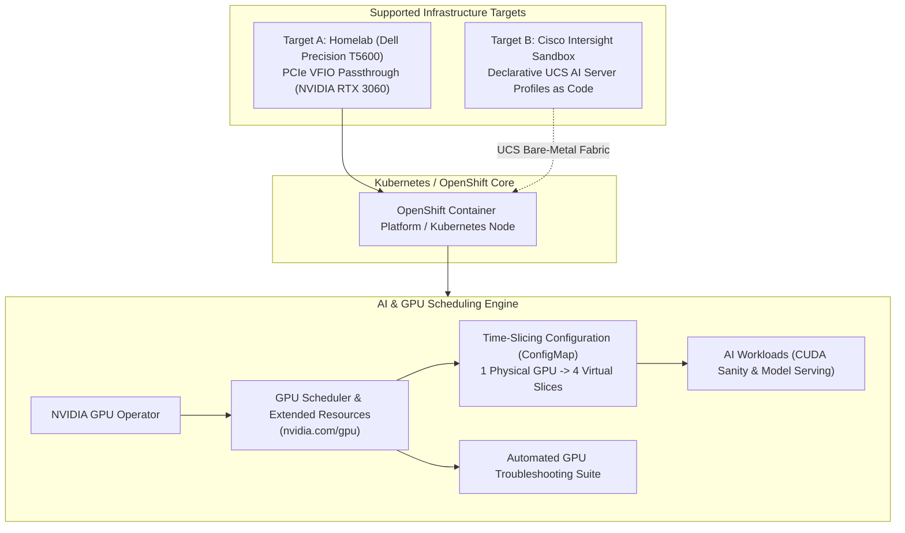

# OpenShift & Kubernetes AI Infrastructure

[](https://github.com/celttechie/openshift-ai-infrastructure)
[](LICENSE)
[](https://opentofu.org/)
[](https://kubernetes.io/)
[](https://github.com/NVIDIA/gpu-operator)
[](https://intersight.com)

A community-oriented, open-source reference platform and lab for learning, deploying, and troubleshooting **Kubernetes and OpenShift AI Infrastructure**, with support for:
1. **On-Prem Homelab GPU Passthrough** (Dell Precision T5600 + NVIDIA RTX 3060).
2. **Cisco Intersight DevNet Sandbox** (Declarative Cisco UCS AI Server Profiles as code).
3. **NVIDIA GPU Operator & Resource Scheduling** (Exclusive access, Time-Slicing multi-tenancy, and diagnostics).

---

## 1. Architecture Overview



---

## 2. Supported Target Environments

| Target | Hardware Required | Purpose & Capabilities |
| :--- | :--- | :--- |
| **`targets/t5600-homelab`** | Precision T5600 KVM Host + NVIDIA GPU | Native PCIe VFIO passthrough directly into OpenShift for true physical CUDA acceleration |
| **`targets/cisco-intersight`** | None (Free Cisco DevNet Sandbox) | Declarative OpenTofu modeling of Cisco UCS X-Series/C-Series AI Server Profiles, BIOS tuning, and RoCEv2 fabrics |

---

## 3. Project Structure

```
openshift-ai-infrastructure/
├── README.md                              # Main portfolio documentation & architectural guide
├── docs/
│   ├── ai-workloads-roadmap.md            # Enterprise AI workloads, LLM serving & RAG roadmap
│   └── gpu-infrastructure-guide.md       # Technical guide on GPU scheduling & failure modes
├── targets/
│   ├── t5600-homelab/                     # Homelab PCIe VFIO GPU Passthrough
│   │   ├── README.md                      # Host configuration runbook (IOMMU, vfio-pci)
│   │   └── gpu-passthrough.tf             # Libvirt XML hostdev attachment module
│   └── cisco-intersight/                  # Cisco DevNet Intersight UCS AI Profiles
│       ├── README.md                      # Free DevNet Sandbox setup guide
│       ├── main.tf / versions.tf          # Provider setup (CiscoDevNet/intersight)
│       ├── policies.tf                    # Low-latency AI BIOS and GPU policies
│       └── server_profile.tf              # Declarative UCS AI Server Profile
├── operators/
│   └── nvidia-gpu-operator/               # GPU Operator Lifecycle
│       ├── cluster-policy.yaml            # ClusterPolicy with CRI-O and DCGM enabled
│       └── time-slicing-config.yaml       # ConfigMap dividing 1 GPU into 4 virtual slices
├── workloads/
│   ├── 01-cuda-vectoradd.yaml             # Sanity check CUDA kernel execution pod
│   ├── 02-exclusive-gpu-pod.yaml          # Dedicated GPU allocation pod (whole GPU)
│   ├── 03-timesliced-gpu-pods.yaml        # Two concurrent pods sharing 1 GPU
│   └── vllm/                              # Production vLLM LLM Inference Serving Engine
│       ├── 00-namespace.yaml              # Dedicated namespace (llm-serving) & ServiceAccount
│       ├── 01-rbac.yaml                   # SCC hostmount binding for local model cache
│       ├── 02-storage.yaml                # PersistentVolume for Hugging Face model weight cache
│       ├── 03-deployment.yaml             # GPU-accelerated vLLM OpenAI-compatible engine
│       ├── 04-service.yaml                # Internal cluster service (port 8000)
│       ├── 05-route.yaml                  # OpenShift Route with Edge TLS termination
│       └── kustomization.yaml             # Declarative GitOps deployment bundle
└── scripts/
    ├── gpu-troubleshoot.sh                # Automated diagnostic & health inspection tool
    └── test-vllm-endpoint.sh              # vLLM endpoint tester & throughput benchmark

---

## 4. Quickstart

### Step 1: Run the GPU Diagnostic Suite
Inspect your host hypervisor, IOMMU grouping, active kernel drivers, and Kubernetes node allocatable resources:
```bash
./scripts/gpu-troubleshoot.sh
```

### Step 2: Deploy Time-Slicing Configuration
To allow multiple AI pods or developers to share a single GPU:
```bash
oc apply -f operators/nvidia-gpu-operator/time-slicing-config.yaml
oc apply -f operators/nvidia-gpu-operator/cluster-policy.yaml
```

### Step 3: Run CUDA Workloads
Test that the Kubernetes scheduler properly mounts the GPU into a container and compiles CUDA code:
```bash
oc apply -f workloads/01-cuda-vectoradd.yaml
oc logs -f cuda-vectoradd-sanity
```

### Step 4: Deploy Production LLM Inference (vLLM)
Deploy an enterprise OpenAI-compatible LLM serving engine (Qwen2.5 / Llama 3.1) with PagedAttention and continuous batching:
```bash
oc apply -k workloads/vllm/
```

### Step 5: Test & Benchmark LLM Inference
Query the OpenShift route, verify the active model, and benchmark token generation throughput:
```bash
./scripts/test-vllm-endpoint.sh "Explain OpenShift AI architecture in two sentences."
```

---

## 5. Architectural & Technical Guides

- **[AI Workloads & LLM Infrastructure Roadmap](docs/ai-workloads-roadmap.md)**: A complete milestone implementation plan covering:
  - 4-phase enterprise roadmap: vLLM serving, Red Hat OpenShift AI (RHOAI), Private RAG, and time-slicing micro-services.
  - Alignment with Cisco AI partnerships, Cisco Validated Designs (CVDs), and on-prem enterprise architectures.
  - Hardware sizing, VRAM budgeting, and verification checklists.
- **[Kubernetes & OpenShift GPU Infrastructure Guide](docs/gpu-infrastructure-guide.md)**: A complete technical reference covering:
  - Why Kubernetes needs device plugins for GPUs.
  - Exclusive allocation vs. Time-Slicing vs. Multi-Instance GPU (MIG).
  - Taints, tolerations, and node protection.
  - The top 5 real-world GPU failure modes and exact troubleshooting commands.
  - How Cisco UCS hardware policies map to Kubernetes compute nodes.

---

## 6. License

Licensed under the Apache License, Version 2.0. See [LICENSE](LICENSE) for details.
