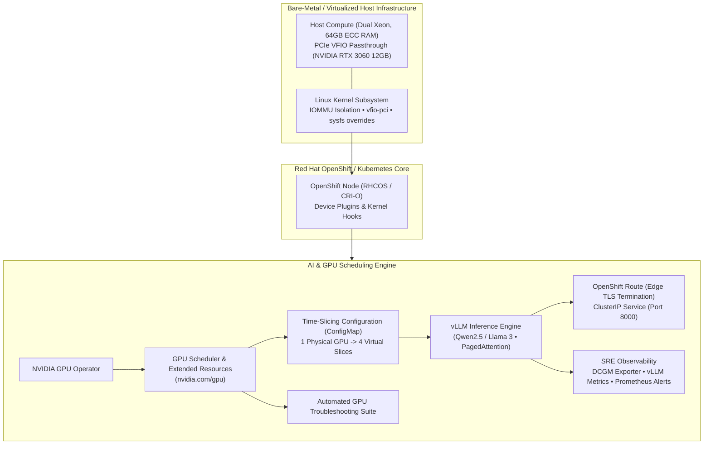

# OpenShift & Kubernetes AI Infrastructure

[](https://github.com/celttechie/openshift-ai-infrastructure)
[](LICENSE)
[](https://opentofu.org/)
[](https://kubernetes.io/)
[](https://github.com/NVIDIA/gpu-operator)
[](docs/ai-workloads-roadmap.md)

A hands-on demo, test, and research project for **Kubernetes and OpenShift AI Infrastructure**, designed to explore unfamiliar hardware and acceleration technologies, stand them up from scratch on real-world systems, and systematically apply Site Reliability Engineering (SRE) principles:
1. **Bare-Metal & Hypervisor GPU Passthrough** (PCIe VFIO driver binding, IOMMU isolation, and host automation).
2. **NVIDIA GPU Operator & Resource Scheduling** (Exclusive compute, Time-Slicing multi-tenancy, and health diagnostics).
3. **Production Model Serving & SRE Hardening** (OpenAI-compatible vLLM serving, OpenShift Route TLS, Prometheus monitoring, and Disruption Budgets).

---

## 1. Architecture Overview



---

## 2. Infrastructure & Target Architecture

| Component | Technology | Purpose & Capabilities |
| :--- | :--- | :--- |
| **Host Hypervisor / Bare-Metal** | Linux KVM / Libvirt (`targets/t5600-homelab`) | Native PCIe VFIO passthrough directly into OpenShift for physical CUDA acceleration |
| **Kubernetes Platform** | Red Hat OpenShift / Kubernetes | Enterprise container orchestration, custom SCC security boundaries, and Edge TLS routing |
| **GPU Operator** | NVIDIA GPU Operator (`operators/nvidia-gpu-operator`) | Automated driver injection, Container Device Interface (CDI), and DCGM telemetry |
| **Serving Runtime** | vLLM Engine (`workloads/vllm`) | OpenAI-compatible high-throughput inference serving with continuous batching and PagedAttention |

---

## 3. Project Structure

```
openshift-ai-infrastructure/
├── README.md                              # Main architecture & research testbed guide
├── docs/
│   ├── ai-workloads-roadmap.md            # Applied SRE roadmap, milestones & research objectives
│   └── gpu-infrastructure-guide.md       # Technical guide on GPU scheduling & failure modes
├── targets/
│   └── t5600-homelab/                     # Host PCIe VFIO GPU Passthrough
│       ├── README.md                      # Host configuration runbook (IOMMU, vfio-pci)
│       ├── gpu-host-admin.py              # Automated host VFIO binding state-machine
│       └── gpu-passthrough.tf             # Libvirt XML hostdev attachment module
├── operators/
│   ├── monitoring/                        # Platform Observability
│   │   └── cluster-monitoring-config.yaml # ConfigMap enabling OpenShift User Workload Monitoring
│   └── nvidia-gpu-operator/               # GPU Operator Lifecycle
│       ├── cluster-policy.yaml            # ClusterPolicy with CRI-O and DCGM enabled
│       └── time-slicing-config.yaml       # ConfigMap dividing 1 GPU into 4 virtual slices
├── workloads/
│   ├── 01-cuda-vectoradd.yaml             # Sanity check CUDA kernel execution pod
│   ├── 02-exclusive-gpu-pod.yaml          # Dedicated GPU allocation pod (whole GPU)
│   ├── 03-timesliced-gpu-pods.yaml        # Two concurrent pods sharing 1 GPU
│   └── vllm/                              # Production vLLM LLM Inference Serving Engine
│       ├── 00-namespace.yaml              # Dedicated namespace (llm-serving) & ServiceAccount
│       ├── 01-rbac.yaml                   # SCC hostmount binding for local model cache
│       ├── 02-storage.yaml                # PersistentVolume for Hugging Face model weight cache
│       ├── 03-deployment.yaml             # GPU-accelerated vLLM OpenAI-compatible engine
│       ├── 04-service.yaml                # Internal cluster service (port 8000)
│       ├── 05-route.yaml                  # OpenShift Route with Edge TLS termination
│       ├── 06-pdb.yaml                    # PodDisruptionBudget (minAvailable: 1)
│       ├── 07-network-policy.yaml         # Ingress network isolation policy
│       ├── monitoring/                    # SRE Observability & Alerts
│       │   ├── prometheus-rules.yaml      # SRE alerts (latency P95, queue saturation, KV cache)
│       │   └── service-monitor.yaml       # User Workload ServiceMonitor for vLLM metrics
│       └── kustomization.yaml             # Declarative GitOps deployment bundle
└── scripts/
    ├── gpu-troubleshoot.sh                # Automated diagnostic & health inspection tool
    ├── run-tests.sh                       # Local 5-suite pre-commit test runner
    └── test-vllm-endpoint.sh              # vLLM endpoint tester & throughput benchmark
```

---

## 4. Quickstart

### Step 1: Run the GPU Diagnostic Suite
Inspect your host hypervisor, IOMMU grouping, active kernel drivers, and Kubernetes node allocatable resources:
```bash
./scripts/gpu-troubleshoot.sh
```

### Step 2: Deploy Time-Slicing Configuration
To allow multiple AI pods or developers to share a single GPU:
```bash
oc apply -f operators/nvidia-gpu-operator/time-slicing-config.yaml
oc apply -f operators/nvidia-gpu-operator/cluster-policy.yaml
```

### Step 3: Run CUDA Workloads
Test that the Kubernetes scheduler properly mounts the GPU into a container and compiles CUDA code:
```bash
oc apply -f workloads/01-cuda-vectoradd.yaml
oc logs -f cuda-vectoradd-sanity
```

### Step 4: Deploy Production LLM Inference (vLLM)
Deploy an enterprise OpenAI-compatible LLM serving engine (Qwen2.5 / Llama 3.1) with PagedAttention and continuous batching:
```bash
oc apply -k workloads/vllm/
```

### Step 5: Test & Benchmark LLM Inference
Query the OpenShift route, verify the active model, and benchmark token generation throughput:
```bash
./scripts/test-vllm-endpoint.sh "Explain OpenShift AI architecture in two sentences."
```

---

## 5. Architectural & Technical Guides

- **[OpenShift AI Infrastructure & Production SRE Roadmap](docs/ai-workloads-roadmap.md)**: A complete milestone implementation plan covering:
  - 4-phase enterprise SRE roadmap: vLLM serving baseline, OpenShift AI & KServe declarative patterns, Linux systems engineering & Day-2 SRE operations, and multi-tenant GPU governance.
  - SRE productionalization: OpenShift User Workload Monitoring, Prometheus alerting rules, PodDisruptionBudgets, and incident post-mortems.
  - Hardware sizing, VRAM budgeting, and Day-2 operational runbooks.
- **[Kubernetes & OpenShift GPU Infrastructure Guide](docs/gpu-infrastructure-guide.md)**: A complete technical reference covering:
  - Why Kubernetes needs device plugins for GPUs.
  - Exclusive allocation vs. Time-Slicing vs. Multi-Instance GPU (MIG).
  - Taints, tolerations, and node protection.
  - The top 5 real-world GPU failure modes and exact troubleshooting commands.
  - How enterprise bare-metal hardware and BIOS policies map to Kubernetes compute nodes.

---

## 6. Testing & CI/CD Guardrails

The repository enforces enterprise quality and safety guardrails across manifests, host automation tools, and workloads.

### Automated Test Layers
* **Static Manifest Linting (`yamllint`)**: Enforces clean Kubernetes formatting across `operators/` and `workloads/`.
* **Python Code Quality (`flake8`)**: Ensures PEP 8 compliance for hypervisor admin tools.
* **Shell Automation Analysis (`shellcheck`)**: Analyzes shell scripts for bash safety, unquoted variables, and robust error handling.
* **Unit Tests & Policy Guardrails (`pytest`)**:
  * Unit tests hypervisor action dispatching (`gpu-host-admin.py`) using mocked state machines.
  * Validates AI architectural rules (e.g. `--enforce-eager` presence, `nvidia.com/gpu` requests/limits, `/dev/shm` memory mounts, `Recreate` deployment strategies, and health probes).
* **Kustomize Build & Schema Validation**: Ensures declarative overlays compile cleanly with `kubectl kustomize`.

### Running Tests Locally
A virtual environment (`.venv`) is automatically managed:
```bash
# Run the complete test suite locally
./scripts/run-tests.sh
```

### GitHub Actions CI
All tests run automatically on every pull request and push to `main` via [`.github/workflows/ci.yml`](.github/workflows/ci.yml).

---

## 7. License

Licensed under the Apache License, Version 2.0. See [LICENSE](LICENSE) for details.

