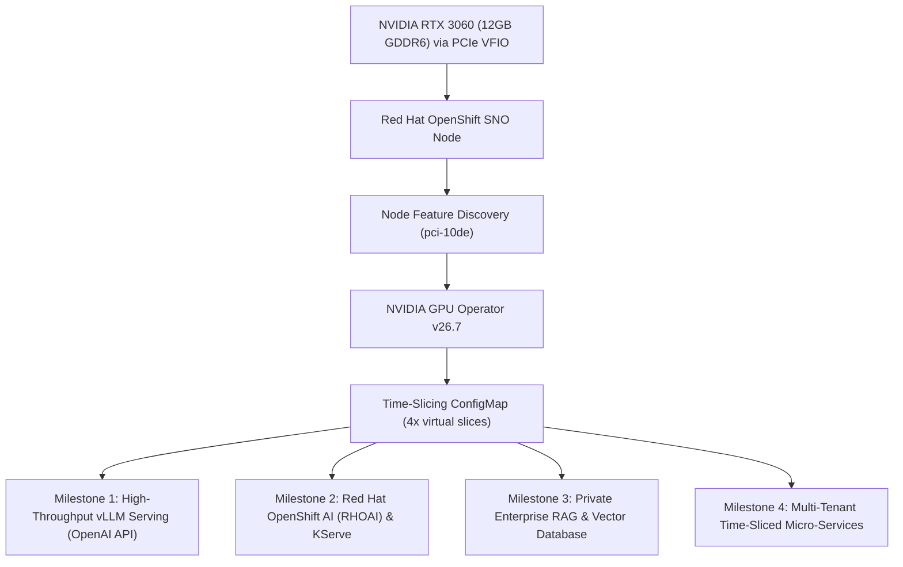

# AI Workloads & LLM Infrastructure Roadmap

A comprehensive, enterprise-aligned architectural roadmap and milestone plan for deploying generative AI, LLM serving engines, and platform operations on OpenShift and Kubernetes.

This document serves as the implementation blueprint and career portfolio roadmap, demonstrating practical mastery over hardware acceleration, modern inference engines, Red Hat OpenShift AI (RHOAI), and private enterprise AI architectures.

---

## 1. Executive Summary & Hardware Budget

### Physical Infrastructure Baseline (Dell Precision T5600 + SNO)
* **GPU**: NVIDIA GeForce RTX 3060 (12GB GDDR6 VRAM, GA106, Compute Capability 8.6 / Ampere).
* **Host Hypervisor**: KVM / Libvirt on Ubuntu LTS, bound to `vfio-pci` without desktop display lockups.
* **Kubernetes Platform**: Red Hat OpenShift 4.22 Single Node OpenShift (SNO `sno-node`), 12 vCPUs, 64GB RAM.
* **Driver & Operator Layer**: NVIDIA GPU Operator `v26.7.2`, Node Feature Discovery (NFD), time-slicing enabled (4x 3GB virtual slices or 1x 12GB exclusive allocation).
* **CPU Architecture Note**: Dual Intel Xeon E5-2670 v1 (`x86-64-v2`, pre-Haswell, no AVX2/AVX-512). DCGM is disabled in ClusterPolicy to ensure glibc stability. **All neural matrix computations must strictly reside on GPU CUDA cores.**

---

## 2. Industry & Enterprise Alignment (Cisco / Red Hat Ecosystem)

Modern enterprise infrastructure teams (e.g., **Cisco**, **Red Hat**, **Dell Enterprise**) are actively transitioning from generic virtualization to specialized **AI Infrastructure Engineering**.

| Enterprise Domain | Industry / Cisco Relevance | How This Repository Demonstrates It |
| :--- | :--- | :--- |
| **Inference Runtime Engine** | Cisco Nexus HyperFabric & UCS AI clusters require high-throughput model engines to serve internal corporate applications. | Deploys containerized **vLLM** with PagedAttention, continuous batching, and streaming token APIs. |
| **Enterprise Platform & MLOps** | Cisco Validated Designs (CVDs) with Red Hat specifically standardize on **Red Hat OpenShift AI (RHOAI)** on Cisco UCS. | Deploys RHOAI, KServe declarative model serving, and interactive GPU data science workbenches. |
| **Private Sovereign AI & RAG** | Enterprise CIOs refuse to send confidential IP, network configs, or code to public third-party APIs. | Implements 100% on-prem **Retrieval-Augmented Generation (RAG)** using Qdrant vector DB and Open-WebUI. |
| **Resource Efficiency & FinOps** | Edge deployments and branch offices cannot justify $30k+ enterprise GPUs for small tasks. | Demonstrates **GPU time-slicing**, packing 4 specialized micro-models onto a single 12GB GPU. |
| **Observability & Telemetry** | Cisco Splunk and ThousandEyes monitor inference latency, API health, and token throughput. | Exposes Prometheus metrics, endpoint health probes, and automated benchmark test suites. |

---

## 3. Implementation Milestones

### Milestone 1: High-Throughput LLM Serving with vLLM (In Progress)
* **Goal**: Turn raw NVIDIA CUDA silicon into an enterprise-grade OpenAI-compatible REST API endpoint on OpenShift.
* **Target Architecture**:
  * Engine: `docker.io/vllm/vllm-openai:latest` requesting `nvidia.com/gpu: 1`.
  * Model: `Qwen/Qwen2.5-3B-Instruct` (or `Qwen/Qwen2.5-7B-Instruct-AWQ` 4-bit quantized).
  * Storage: Local `PersistentVolume` (`/var/mnt/models`) on host disk to cache Hugging Face weights across restarts.
  * Ingress: OpenShift Route with Edge TLS termination exposing `/v1/chat/completions` and `/v1/models`.
* **Deliverables**:
  * [x] Namespace and RBAC manifests with `hostmount-anyuid` SCC (`workloads/vllm/00-namespace.yaml`, `01-rbac.yaml`).
  * [x] PersistentVolume and Claim for model cache (`workloads/vllm/02-storage.yaml`).
  * [x] GPU-accelerated Deployment, Service, and Route (`workloads/vllm/03-deployment.yaml`, `04-service.yaml`, `05-route.yaml`).
  * [x] Automated benchmark script measuring TTFT and tokens/sec (`scripts/test-vllm-endpoint.sh`).
  * [ ] Live verification and latency benchmark output captured in documentation.

---

### Milestone 2: Red Hat OpenShift AI (RHOAI / Open Data Hub) & KServe
* **Goal**: Deploy Red Hat's official enterprise AI platform, matching Cisco Validated Designs (CVDs) for OpenShift AI.
* **Target Architecture**:
  * Operator: Red Hat OpenShift AI Operator (or upstream Open Data Hub / ODH) installed via OperatorHub.
  * Model Serving: **KServe** / **ModelMesh** declarative serving runtimes using Custom Resource Definitions (`InferenceService`).
  * Storage: MinIO or local S3-compatible object store for model registry.
  * Data Science Workbenches: Self-service JupyterLab workbench with CUDA GPU acceleration.
* **Deliverables**:
  * [ ] RHOAI / ODH Subscription and DataScienceCluster CRD.
  * [ ] KServe ServingRuntime definition for vLLM.
  * [ ] S3-backed model storage bucket and secret.
  * [ ] Sample declarative `InferenceService` deployment and smoke test.

---

### Milestone 3: Private Enterprise RAG & Knowledge Base
* **Goal**: Build an end-to-end private enterprise AI assistant capable of answering technical questions from internal documentation without internet access.
* **Target Architecture**:
  * Vector Database: **Qdrant** or **PostgreSQL + pgvector** deployed as a StatefulSet on OpenShift.
  * Embedding Worker: Lightweight embedding model (`BAAI/bge-large-en-v1.5` or `nomic-embed-text`) consuming <1GB VRAM.
  * Frontend UI: **Open-WebUI** containerized with OpenShift OAuth/SSO integration.
  * Ingestion Pipeline: Ingestion script parsing Cisco documentation, RFCs, and homelab architecture runbooks.
* **Deliverables**:
  * [ ] Vector database deployment manifests with persistent storage.
  * [ ] Embedding service deployment and endpoint configuration.
  * [ ] Open-WebUI deployment with Route and persistent data.
  * [ ] Ingestion script indexing repository documentation.
  * [ ] Verification query proving grounded answers with citations.

---

### Milestone 4: Multi-Tenant Micro-Inference & Time-Slicing Optimization
* **Goal**: Showcase advanced Kubernetes GPU resource optimization by co-locating 4 specialized AI microservices concurrently on 1 physical GPU.
* **Target Architecture**:
  * **Slice 1 (3GB VRAM)**: Audio / Speech-to-Text (`openai/whisper-large-v3-turbo` or `whisper-medium`).
  * **Slice 2 (3GB VRAM)**: Dense Text Embeddings & Semantic Search (`BAAI/bge-m3`).
  * **Slice 3 (3GB VRAM)**: Lightweight Reasoning & Summarization (`Qwen/Qwen2.5-1.5B-Instruct` or `Phi-3.5-mini`).
  * **Slice 4 (3GB VRAM)**: Vision / Document OCR (`moondream2` or `SmolVLM`).
* **Deliverables**:
  * [ ] Separate namespace and deployment manifest for each microservice.
  * [ ] Concurrent stress-test script proving simultaneous execution with zero OOM crashes.
  * [ ] GPU utilization telemetry report showing multi-tenant resource sharing.

---

## 4. Portfolio Demonstration & Verification Plan

For each milestone completed, the repository will contain:
1. **Declarative GitOps Manifests**: Fully reproducible via `oc apply -k ...`.
2. **Automated Verification Script**: A CLI tester that returns exit code `0` on success and prints latency/throughput metrics.
3. **Execution Logs & Metrics**: Saved benchmark outputs proving real-world performance on physical hardware.
