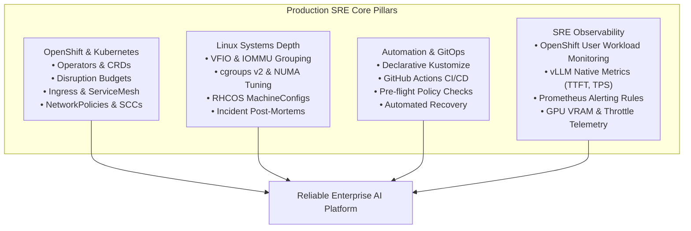

# OpenShift AI Infrastructure & Production SRE Roadmap

A hands-on demonstration, testbed, and research project focused on mastering unfamiliar technologies, standing up complex GPU acceleration on constrained hardware from scratch, and systematically applying Site Reliability Engineering (SRE) principles to achieve production readiness.

This document serves as the architectural blueprint and operational roadmap for platform engineering, systems reliability, Linux kernel optimization, and automation workflows across the lifecycle of GPU-accelerated infrastructure.

---

## 1. Project Mission & Research Objectives

### Technical Philosophy
Standing up cutting-edge AI workloads on modern platforms requires more than deploying off-the-shelf manifests. This project demonstrates:
1. **Rapidly Learning Unfamiliar Technologies**: Grasping complex, heterogeneous layers—from low-level PCIe VFIO passthrough and kernel driver isolation to NVIDIA GPU Operator internals and vLLM continuous batching—and getting them running reliably end-to-end.
2. **Applying Production SRE Principles**: Treating infrastructure as software, building observable feedback loops, establishing automated guardrails, ensuring workload disruption tolerance, and conducting blameless incident investigations.
3. **Overcoming Real-World Hardware Constraints**: Engineering around physical limits (memory ceilings, legacy CPU instruction sets, power envelopes) using disciplined architectural constraints rather than brute-force hardware scaling.

### Physical Infrastructure Baseline & Hardware Constraints
* **Physical Hypervisor**: Dell Precision T5600 workstation.
  * **Compute**: Dual Intel Xeon E5-2670 v1 (16 physical cores / 32 threads, `x86-64-v2`, pre-Haswell, no AVX2/AVX-512).
  * **Memory**: 64GB DDR3 ECC Registered RAM.
  * **GPU Acceleration**: NVIDIA GeForce RTX 3060 (12GB GDDR6 VRAM, GA106, Compute Capability 8.6 / Ampere, PCIe 3.0 x16).
  * **Hypervisor OS**: Ubuntu LTS with KVM / Libvirt, custom VFIO driver override automation.
* **Kubernetes Platform**: Red Hat OpenShift 4.22 Single Node OpenShift (SNO `sno-node`), 12 vCPUs, 32GB RAM.
* **GPU & Acceleration Layer**: NVIDIA GPU Operator `v26.7.2`, Node Feature Discovery (NFD), time-slicing enabled (4x 3GB virtual slices or 1x 12GB exclusive allocation).
* **Hardware Operational Guardrails**:
  1. **Strict GPU CUDA Compute**: The legacy Xeon E5-2670 CPUs lack AVX2 instructions. All neural tensor math must strictly execute on GPU CUDA cores; any CPU fallback results in massive latency or thermal trips.
  2. **Eager Execution Protection**: vLLM must run with `--enforce-eager` to disable PyTorch Inductor multi-core JIT compilation and CUDA graph capture, keeping host CPU and power consumption completely stable.
  3. **Recreate Deployment Strategy**: Due to single-GPU passthrough constraints on SNO, workloads must utilize `strategy: { type: Recreate }` to prevent multi-pod VRAM exhaustion during rolling updates.

---

## 2. Research Focus & Applied SRE Principles

| Domain | System Challenge & Research Focus | Applied SRE Approach & Implementation |
| :--- | :--- | :--- |
| **OpenShift & Kubernetes** | Orchestrating GPU workloads on constrained single-node clusters without control-plane bloat. | Implements containerized vLLM, KServe `ServingRuntime` patterns, Edge TLS routes, and custom SCC security boundaries. |
| **SRE Productionalization** | Preventing silent failures, cascading brownouts, and downtime during node maintenance. | Implements `PodDisruptionBudget`, `terminationGracePeriodSeconds` request draining, and OpenShift User Workload Monitoring. |
| **Linux Systems Engineering** | Managing hardware passthrough, kernel driver binding conflicts, and cgroups resource limits. | Automates host VFIO binding (`gpu-host-admin.py`), audits IOMMU isolation, and documents RHCOS MachineConfig tuning. |
| **Automation & GitOps** | Eliminating manual operational drift and validating architectural policies before deployment. | Full GitHub Actions CI validating schemas (`kubeconform`), linting (`yamllint`), shell safety (`shellcheck`), and Python unit tests (`pytest`). |
| **Incident Investigation & RCA** | Diagnosing complex, cross-cutting hardware/software failure modes under heavy load. | Conducts blameless post-mortems with root cause analysis (e.g. PyTorch Inductor CPU power trip) and codifies architectural mitigations into automated tests. |

---

## 3. Four Core SRE Production Milestones

### Milestone 1: High-Throughput Inference Baseline & SRE Production Hardening
* **Status**: **Baseline Complete (PR #3 Merged); SRE Hardening In Progress**
* **Objective**: Establish the core OpenAI-compatible vLLM serving engine on SNO and harden it with enterprise SRE guardrails.
* **Core Inference Deliverables**:
  * [x] Namespace and RBAC manifests with OpenShift SCC bindings (`workloads/vllm/00-namespace.yaml`, `01-rbac.yaml`).
  * [x] PersistentVolume and Claim for Hugging Face model cache (`workloads/vllm/02-storage.yaml`).
  * [x] Declarative vLLM Deployment serving `Qwen/Qwen2.5-3B-Instruct` with `--enforce-eager` and `strategy: Recreate` (`workloads/vllm/03-deployment.yaml`).
  * [x] ClusterIP Service and Edge TLS Ingress Route (`workloads/vllm/04-service.yaml`, `05-route.yaml`).
  * [x] Automated CLI benchmark script measuring TTFT, tokens/sec, and health (`scripts/test-vllm-endpoint.sh`).
* **SRE Hardening Deliverables**:
  * [x] **OpenShift User Workload Monitoring**: Deploy `ServiceMonitor` targeting vLLM's native `/metrics` endpoint on port 8000 (`workloads/vllm/monitoring/service-monitor.yaml`) and cluster config (`operators/monitoring/cluster-monitoring-config.yaml`).
  * [x] **Prometheus Alerting Rules**: Create `PrometheusRule` defining alerts for high request latency, queue saturation, and GPU VRAM exhaustion (`workloads/vllm/monitoring/prometheus-rules.yaml`).
  * [x] **Workload Resilience**: Implement `PodDisruptionBudget` (`minAvailable: 1`) in `workloads/vllm/06-pdb.yaml` and configure `terminationGracePeriodSeconds: 60` for graceful in-flight request draining.
  * [x] **Network Isolation**: Implement OpenShift `NetworkPolicy` restricting ingress to authorized OpenShift routers and Prometheus monitoring pods (`workloads/vllm/07-network-policy.yaml`).
  * [x] **Policy Guardrail & Unit Tests**: Automated pytest suite validating termination grace periods, PDB constraints, alerting rules, and Kustomize build (`tests/test_manifest_policies.py`).
  * [ ] **Security Posture Review**: Scope SCC permissions from broad `privileged` access toward specific Linux capabilities (`IPC_LOCK`, `SYS_PTRACE`).

---

### Milestone 2: Declarative OpenShift AI (RHOAI) & KServe ServingRuntime Patterns
* **Status**: **Planned**
* **Objective**: Deliver enterprise OpenShift AI / KServe declarative serving patterns without the cluster footprint of full upstream Open Data Hub (ODH) on resource-constrained SNO.
* **Architecture Strategy**:
  * Avoid installing the full heavy RHOAI operator bundle (which consumes >16GB RAM for Kubeflow, Elyra, Dashboard, and Knative components).
  * Deliver the **exact declarative Custom Resources** that OpenShift AI uses under the hood: `ServingRuntime` and `InferenceService`.
* **Deliverables**:
  * [ ] **vLLM ServingRuntime Manifest**: Define an OpenShift AI `ServingRuntime` custom resource specifying container images, arguments, ports, and multi-model capabilities (`workloads/rhoai-kserve/serving-runtime.yaml`).
  * [ ] **Declarative InferenceService**: Define a KServe `InferenceService` spec showcasing how enterprise platforms decouple model storage, runtime environments, and autoscaling (`workloads/rhoai-kserve/inference-service.yaml`).
  * [ ] **Model Storage Architecture Pattern**: Document the transition from local `hostPath` storage to enterprise S3-compatible model registries (e.g., MinIO or AWS S3) with secure IAM credentials.
  * [ ] **Deployment Topology Comparison Guide**: A technical reference comparing Single-Model Serving, ModelMesh, and vLLM continuous batching for enterprise architects (`docs/model-serving-topologies.md`).

---

### Milestone 3: Linux Systems Engineering, Day-2 SRE Operations & Post-Mortems
* **Status**: **Planned**
* **Objective**: Demonstrate deep Linux kernel troubleshooting, immutable OS awareness (RHCOS), and production incident resolution.
* **Deliverables**:
  * [ ] **Incident Post-Mortem 001**: Document the real-world Xeon E5 JIT power-trip incident (`docs/post-mortems/2026-10-21-cpu-jit-psu-deadlock.md`):
    * Summary, Timeline, Impact, and Root Cause Analysis (RCA).
    * Deep-dive: PyTorch Inductor thread exhaustion + AVX2 absence + GPU peak draw triggering hardware PSU shutdown.
    * Permanent engineering fixes: `--enforce-eager` and `strategy: Recreate`.
  * [ ] **Linux Hardware & Kernel Guide**: Detailed technical notes on PCIe passthrough, IOMMU grouping, sysfs driver overrides, and cgroups v2 GPU accounting (`docs/linux-kernel-and-hardware.md`).
  * [ ] **RHCOS MachineConfig Concepts**: Examples of how OpenShift applies immutable kernel arguments (`intel_iommu=on`, `hugepages=1G`) via MachineConfig operator.
  * [ ] **Day-2 SRE Operational Runbooks**:
    * Runbook 1: GPU Hardware Hang & VFIO Reset Procedure (`docs/runbooks/gpu-recovery.md`).
    * Runbook 2: Node Drain & GPU Workload Evacuation Procedure (`docs/runbooks/node-drain.md`).
    * Runbook 3: NVIDIA Driver & Operator Version Upgrade Procedure (`docs/runbooks/driver-upgrade.md`).

---

### Milestone 4: Multi-Tenant GPU Time-Slicing & Automated GitOps Delivery
* **Status**: **Planned**
* **Objective**: Optimize GPU resource allocation, enforce multi-tenant quotas, and establish declarative GitOps promotion.
* **Deliverables**:
  * [ ] **Multi-Tenant Slice Allocation**: Deploy 4 distinct microservice namespaces sharing the RTX 3060 via NVIDIA Time-Slicing (Embeddings, Lightweight LLM, Classifier, Health Validator).
  * [ ] **Kubernetes Resource Governance**: Implement `ResourceQuota` and `LimitRange` per namespace to prevent any single tenant from monopolizing GPU slices or host memory.
  * [ ] **OpenShift GitOps / ArgoCD Declarations**: Add declarative Application manifests (`gitops/application-vllm.yaml`) showing how GitOps controllers automate deployment synchronization from git.
  * [ ] **Automated Multi-Tenant Load Testing**: A stress-testing script validating that concurrent client queries against multiple time-sliced models execute reliably without CUDA OOMs.

---

## 4. Application-Layer Extensions (Deferred)

In alignment with core infrastructure engineering and SRE priorities, user-facing application layers are deliberately deferred:

* **Interactive Web UIs (Open-WebUI / Chatbot frontends)**: Deferred. In an enterprise infrastructure team, the customer is typically an internal development team, API gateway, or automated pipeline—not a casual chatbot user.
* **Private RAG Vector Pipelines (Qdrant / ChromaDB / Ingestion Scripts)**: Deferred. RAG is an application-tier workload; prioritizing it prematurely detracts from demonstrating core Kubernetes, Linux, and SRE production competencies.
* **JupyterLab Self-Service Notebooks**: Deferred. Focus remains on automated model serving rather than exploratory data science workbenches.

