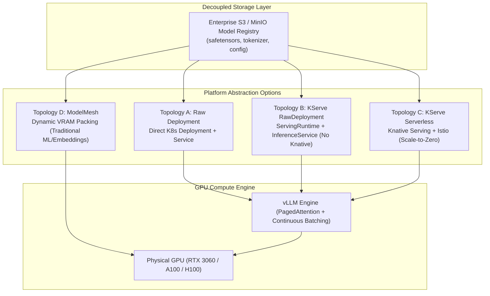

# Enterprise Model Serving Topologies on Kubernetes & OpenShift

A technical architectural reference evaluating model serving patterns, runtime abstraction layers, and operational trade-offs for deploying Large Language Models (LLMs) and foundation models on enterprise Kubernetes and Red Hat OpenShift.

---

## 1. Executive Summary & Architectural Dilemma

Serving AI models in production requires choosing how to reconcile high-throughput GPU inference engines with standard cloud-native Kubernetes orchestration:

Selecting the wrong topology leads to:
1. **Control-plane bloat**: Installing the entire Open Data Hub (ODH) / Red Hat OpenShift AI (RHOAI) operator bundle consumes >16GB RAM for Knative, Istio, Elyra, and dashboard pods—often starving single-node or edge clusters before workloads even start.
2. **Cold-start latency traps**: Attempting "scale-to-zero" with 7B+ LLMs forces users to wait 60–120 seconds while 14GB of weights pull from S3 and allocate to VRAM.
3. **GPU fragmentation**: Failing to decouple model storage from container runtime makes rolling deployments and A/B testing slow and error-prone.

---

## 2. Detailed Topology Breakdown

### Topology A: Standalone Container Deployment (Native K8s Deployment)
* **How It Works**: Standard Kubernetes `Deployment` invoking `vllm serve <model>` directly, with a `PersistentVolumeClaim` or local mount for model weight cache.
* **Pros**:
  * Lowest overhead: Zero operator dependencies or CRDs required.
  * Direct access to all vLLM CLI arguments (`--enforce-eager`, `--gpu-memory-utilization`).
  * Minimal cluster memory footprint (<50MB for kubelet/cgroups).
* **Cons**:
  * Tight coupling between container configuration, storage paths, and model versions.
  * Lacks standard multi-model abstraction or unified API routing across different model runtimes.
* **Best Used For**: Homelabs, resource-constrained SNO, edge devices, and dedicated single-model microservices.

---

### Topology B: KServe RawDeployment (OpenShift AI Modern Standard)
* **How It Works**: Separates the runtime environment (`ServingRuntime`) from the model deployment (`InferenceService`) using `serving.kserve.io/deploymentMode: RawDeployment`.
  - The `ServingRuntime` defines *how* the engine runs (container image, args, ports, shared memory mounts).
  - The `InferenceService` defines *what* is served (model format, target runtime, S3 storage connection key, and resource quotas).
* **Pros**:
  * **Zero Knative/Istio Footprint**: Generates standard Kubernetes Deployments, Services, and Routes behind the scenes.
  * Clean separation of concerns: Platform engineers manage `ServingRuntime`; Data scientists manage `InferenceService`.
  * Standardized S3 model loading via storage initializers.
* **Cons**:
  * Requires KServe CRDs and mutating webhooks.
* **Best Used For**: Enterprise OpenShift AI clusters, dedicated GPU inference endpoints, and multi-tenant platforms where Knative service mesh is unnecessary overhead.

---

### Topology C: Serverless KServe (Knative Serving + Istio Service Mesh)
* **How It Works**: Uses Knative Serving to dynamically route requests, scale pods based on concurrency, and scale to zero when idle.
* **Pros**:
  * Dynamic scale-to-zero saves GPU compute costs during prolonged inactivity.
  * Traffic splitting for canary and blue/green rollouts at the ingress gateway.
* **Cons**:
  * **Severe Cold-Start Penalty**: Pulling multi-gigabyte models from S3 and loading weights into VRAM takes 45–180 seconds.
  * **Massive Resource Overhead**: Knative Serving, Istio, and cert-manager consume 8–16GB RAM across control-plane pods.
  * Incompatible with continuous batching patterns where keeping the KV cache warm is critical for sub-second latency.
* **Best Used For**: Multi-node enterprise cloud clusters with bursty, unpredictable traffic where models are small (<1GB) or latency SLA allows a warm-up period.

---

### Topology D: ModelMesh (High-Density Multi-Model Serving)
* **How It Works**: An intelligent model-routing proxy that dynamically loads and unloads models in and out of GPU/CPU memory across a shared pool of pods.
* **Pros**:
  * Maximizes resource efficiency: Host hundreds of rarely-used models across a handful of nodes.
  * Fast switching for small models.
* **Cons**:
  * Not designed for modern LLMs: Cannot leverage vLLM PagedAttention or continuous batching across multiple concurrent large models.
  * Limited to Triton, MLServer, or OpenVINO runtimes.
* **Best Used For**: Classical ML models (scikit-learn, XGBoost) and small embedding/classifier models (<500MB).

---

## 3. Comprehensive Architectural Comparison Matrix

| Evaluation Dimension | Topology A: Raw Deployment | Topology B: KServe RawDeployment | Topology C: KServe Serverless | Topology D: ModelMesh |
| :--- | :--- | :--- | :--- | :--- |
| **Control Plane Overhead** | 0 MB (Native K8s) | ~200 MB (KServe Controller) | 8–16 GB (Knative + Istio) | 2–4 GB (ModelMesh Controller) |
| **CRDs Required** | None | `ServingRuntime`, `InferenceService` | Full Knative + Istio CRD suites | ModelMesh CRDs |
| **Scale to Zero** | No | No (Explicit replicas) | Yes (Knative Autoscaler) | LRU Memory Eviction |
| **Cold Start Latency** | None (Always Warm) | None (Always Warm) | 45s–180s (VRAM Reload) | 5s–30s (Dynamic Load) |
| **Continuous Batching** | Native (vLLM Engine) | Native (vLLM Engine) | Complex (Knative Concurrency) | Not Supported |
| **Storage Decoupling** | Manual (PVC / HostPath) | Declarative (S3 Data Connection) | Declarative (S3 Data Connection) | Declarative (S3 Registry) |
| **Operational Complexity** | Low | Low–Medium | Very High | High |
| **Ideal Hardware Profile** | Edge / SNO (1 Node, 32GB RAM) | Private Cloud / SNO (32–64GB RAM) | Large Cloud Clusters (6+ Nodes) | Shared Multi-Tenant CPU/GPU |

---

## 4. Model Storage Architecture: Decoupling Weights from Images

In a mature enterprise architecture, **container images never bundle model weights**. 

### The Enterprise Pattern
1. **Model Registry (S3 / Ceph / MinIO)**:
   - Model weights (`safetensors`), configuration (`config.json`), and tokenizer files reside in an S3 bucket under a versioned path (`models/Qwen2.5-3B-Instruct/v1/`).
2. **OpenShift AI Data Connection (`Secret`)**:
   - A namespaced secret (`workloads/rhoai-kserve/storage-connection.yaml`) injects S3 credentials, endpoints, and bucket names via IAM or access keys.
3. **Decoupled Storage Initializer**:
   - KServe's storage initializer pod downloads the artifacts into a shared volume before the runtime container starts.
   - The runtime container mounts `/mnt/models` and begins serving without having to rebuild container images.

---

## 5. SRE Recommendations

1. **For Constrained & Single-Node OpenShift (SNO)**:
   - Standardize on **Topology B (KServe RawDeployment)** or **Topology A (Raw Deployment)**.
   - Strictly avoid Knative Serverless on SNO: The overhead of Istio and Knative control planes consumes critical RAM that should be allocated to system buffers, host OS, and the Kubernetes API.
2. **For High-Throughput LLM Workloads**:
   - Standardize on vLLM with PagedAttention and continuous batching. Avoid dynamic loading/unloading topologies (ModelMesh) for models > 3B parameters due to VRAM thrashing.
3. **For Production GitOps**:
   - Commit declarative `ServingRuntime` and `InferenceService` manifests to git; automate promotion with ArgoCD.
